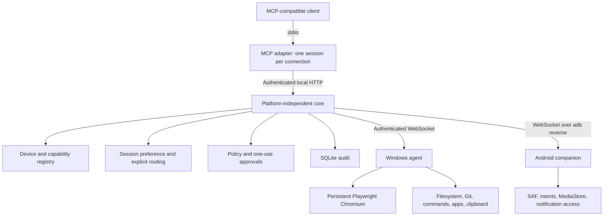
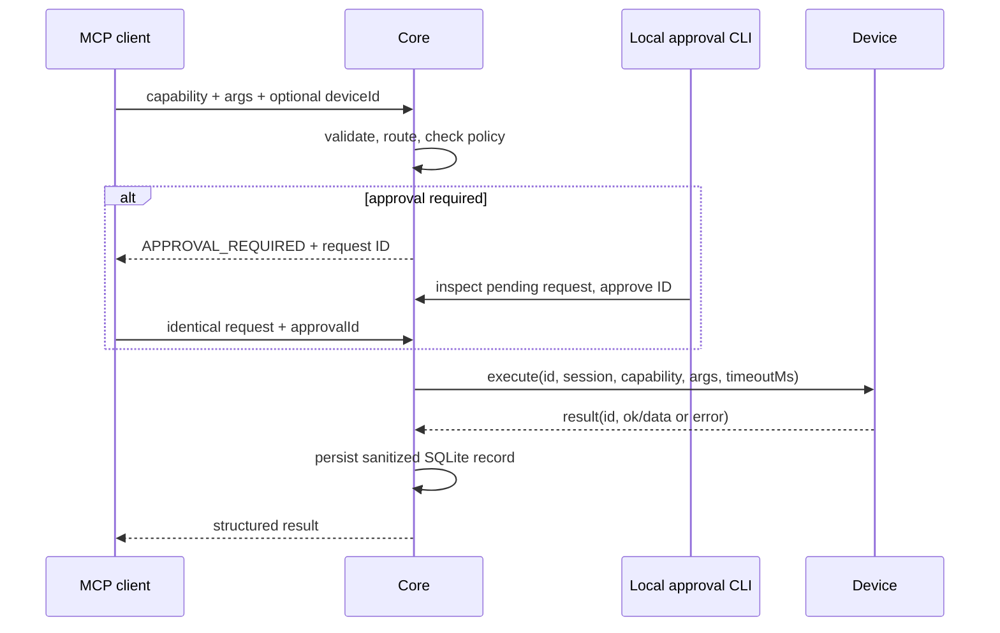

# Architecture

Personal MCP OS is a local execution layer. The MCP adapter uses the official TypeScript SDK 1.30.0 and stdio. The core daemon owns routing, authorization and audit. A separate Windows process executes capabilities. A native Android application connects through an authenticated WebSocket using a USB reverse tunnel.

## Ownership

| Component                       | Responsibility                                          |
| ------------------------------- | ------------------------------------------------------- |
| `apps/mcp-server/src/main.ts`   | MCP tools, resources and connection session             |
| `apps/mcp-server/src/daemon.ts` | Authenticated HTTP/WebSocket transport, pairing, health |
| `apps/mcp-server/src/core.ts`   | Registry, routing, approvals, dispatch, audit           |
| `apps/windows-agent`            | OS implementation and serial execution queue            |
| `apps/android-agent`            | Native Android Gradle application                       |
| `packages/protocol`             | Device, session, capability and request/result types    |
| `packages/capabilities`         | Central validated tool catalog and risk metadata        |
| `packages/security`             | Root checks, redaction, policy, OS credential vault     |
| `packages/shared`               | Configuration and SQLite persistence                    |

Routing priority is explicit `deviceId`, then the session preference, then the only compatible online device. An unavailable preferred device produces an error; it never silently reroutes. Two compatible online devices require selection. Each MCP adapter process has a fresh session. Device connections, sessions and approvals are in memory; audit and paired identities persist.

WebSocket messages are `register`, `registered`, `execute`, `result`, `cancel`, and `heartbeat`. Requests use UUIDs. The core accepts results only from the assigned device and for an outstanding ID. The core expires requests, sends cancellation, detects lost connections and resolves pending calls with structured errors. Windows retries connections every three seconds and emits heartbeats every ten seconds. The core also uses WebSocket ping/pong.

SQLite is provided by sql.js (the SQLite engine compiled to WebAssembly), avoiding native Node ABI installation issues on Windows. One daemon owns the database; after each audit insertion it writes a temporary database image and atomically renames it. This is suitable for personal workloads. It is not a multi-process SQLite writer design, and audit cost grows with database size.

Future remote agents can reuse the identity/capability/request protocol. V1 deliberately accepts loopback traffic only. A future remote transport needs TLS, identity revocation, transport authorization and deployment hardening; changing routing or platform capability interfaces is unnecessary.

## Verified API sources

- [Official MCP SDK server APIs](https://ts.sdk.modelcontextprotocol.io/server)
- [Official MCP SDK client APIs](https://ts.sdk.modelcontextprotocol.io/client)
- [Playwright semantic locators](https://playwright.dev/docs/api/class-locator)
- [Android Storage Access Framework](https://developer.android.com/training/data-storage/shared/documents-files)
- [Android notification listener](https://developer.android.com/reference/android/service/notification/NotificationListenerService)
